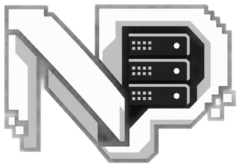
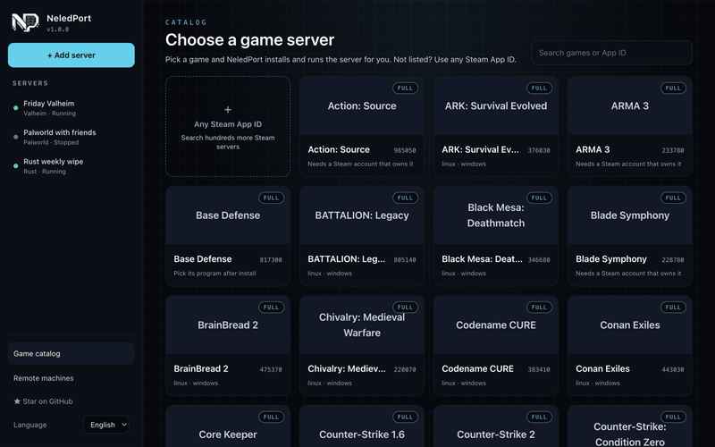
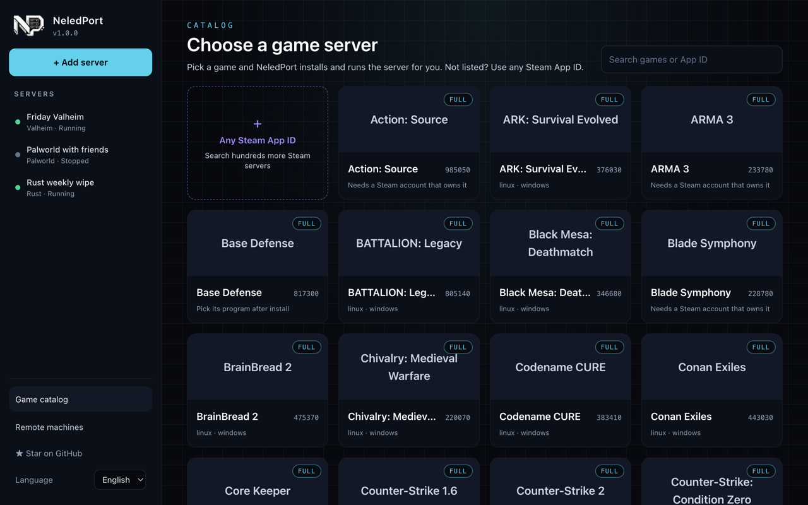
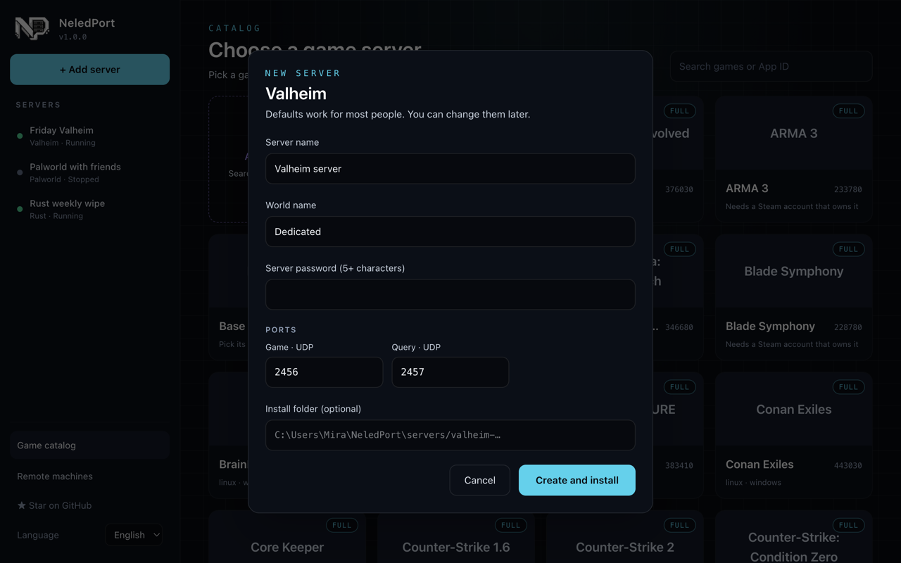
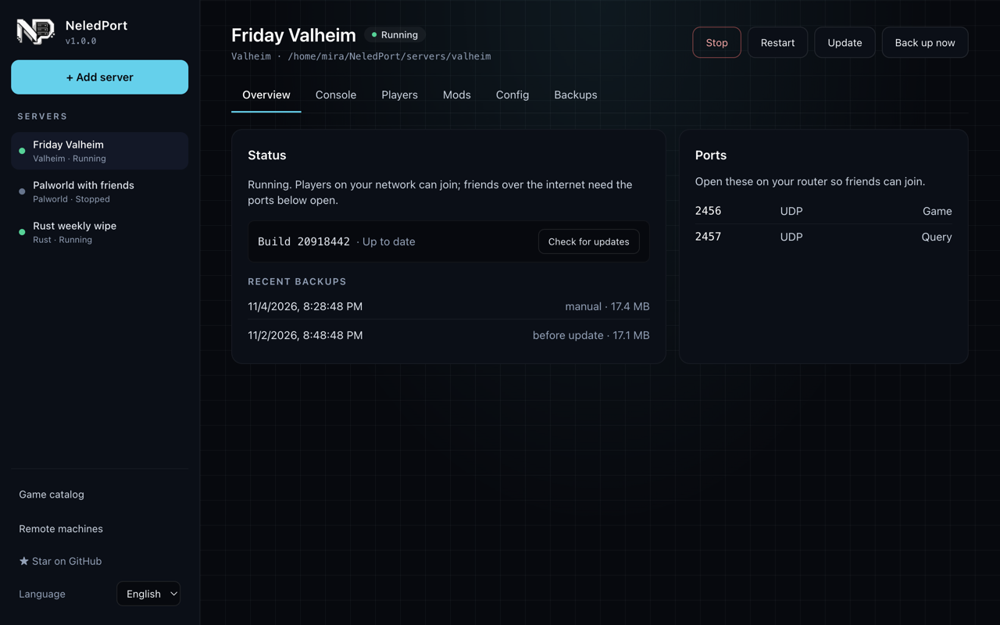
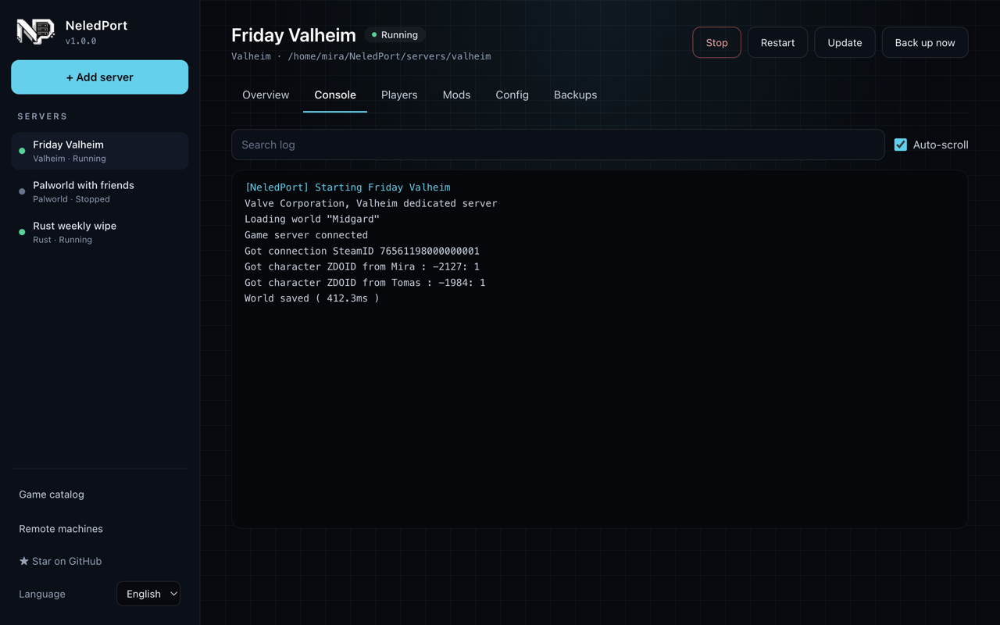
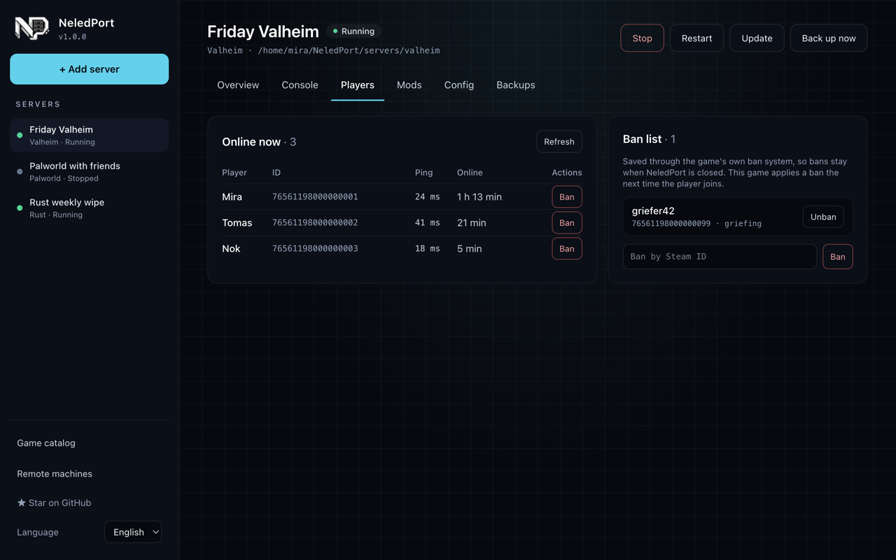
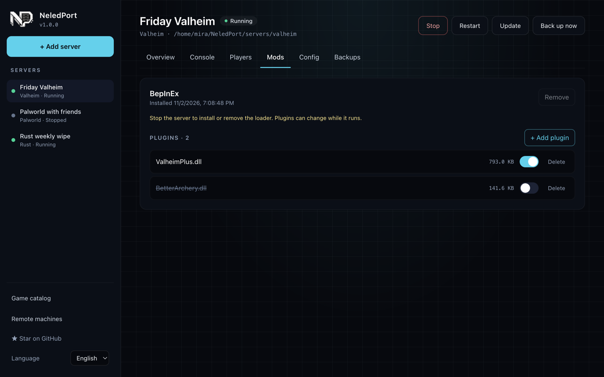
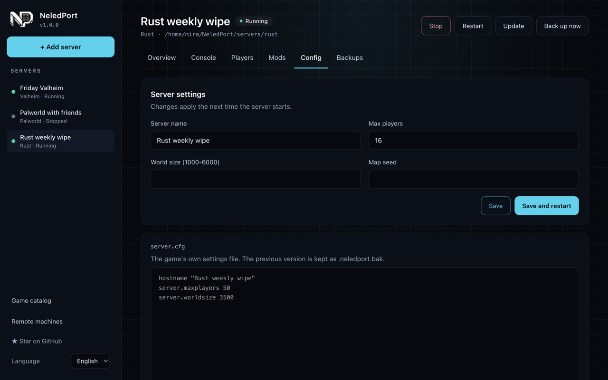
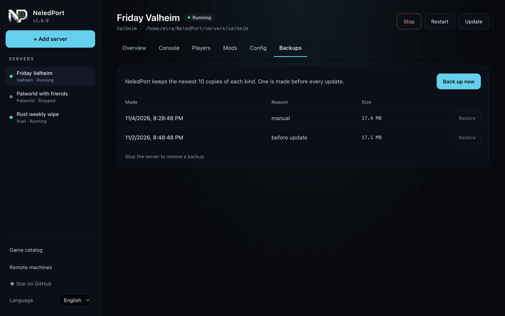

<div align="center">



# NeledPort

**Host Steam dedicated game servers from one modern desktop app.**
Install, run, watch, moderate and mod your server: no terminal required.

[](https://github.com/NexwestLedgerCoreCompanyLimited/NeledPort/actions/workflows/ci.yml)
[](https://github.com/NexwestLedgerCoreCompanyLimited/NeledPort/releases)
[](LICENSE)


English · [ภาษาไทย](README.th.md)



</div>

> NeledPort is in early development. Star the repo to follow along, or [add your favourite game](CONTRIBUTING.md#add-a-game) to the catalog.

## Why

Running a dedicated server today means SteamCMD commands, hand-edited config files and a terminal you can't close.
NeledPort wraps all of that in a desktop app for Windows and Linux.

## Features

- **One-click install.** NeledPort downloads SteamCMD for you, then installs, updates and validates servers.
- **Start, stop, restart** with graceful shutdown, so worlds are saved first.
- **Live console** with search and a command box, through whatever the game speaks: RCON, WebRCON, BattlEye RCon, a
  web admin, a server API, telnet or the server's own console.
- **Players and bans:** kick, ban and unban through each game's own mechanism.
- **Mods:** one-click server-side mod loaders (BepInEx for Valheim, Oxide for Rust and Hurtworld, SourceMod for 23
  Source games, Metamod:Source for CS2, AMX Mod X for 8 Half-Life games), a plugin manager, and Steam Workshop maps
  for CS2.
- **Config:** change a server's settings after creating it, and edit the game's own config files in the app. The
  previous file is kept.
- **Backups:** made automatically before every update, or with **Back up now**. Restore one in a click; the current
  world is moved aside, never deleted.
- **Remote machines:** watch and control the servers on a Linux VPS or a Windows Server from the app on your PC.
  Each paired device has its own key and role (view or control), connections are encrypted with it, and every action is
  logged. [How it works and how it is protected](docs/REMOTE.md).
- **No screen needed:** `neledport serve` hosts servers on a Linux server, from one `npx` command
  ([setup](docs/REMOTE.md#run-neledport-on-a-linux-server-without-a-screen)).
- **AI over MCP:** `neledport mcp` lets Claude or another MCP client list, start, stop and manage servers
  ([setup](docs/REMOTE.md#let-an-ai-run-it-mcp)).
- **Speaks your language:** English and Thai today, and [adding yours](CONTRIBUTING.md#translate-neledport) is one file.

Planned: uptime and CPU/RAM graphs, a command palette, a light theme.

<details>
<summary>Screenshots (sample servers)</summary>

| | |
|---|---|
|  |  |
|  |  |
|  |  |
|  |  |

</details>

## Download

Get the latest installer for Windows (`.exe`) or Linux (`.AppImage`, `.deb`) from
[Releases](https://github.com/NexwestLedgerCoreCompanyLimited/NeledPort/releases). What changed in each version is in the
[changelog](CHANGELOG.md).

NeledPort updates itself on Windows and with the AppImage: when a new version is ready, press **Restart to update**.
With the `.deb`, install the new `.deb` from Releases.

> Builds are not code-signed yet, so Windows SmartScreen may warn on first launch: choose **More info → Run anyway**.

On a Linux server without a screen (Node.js 20.10+):

```bash
npx --yes --package https://github.com/NexwestLedgerCoreCompanyLimited/NeledPort/releases/latest/download/neledport.tgz neledport serve
```

[Commands, systemd, remote access and MCP](docs/REMOTE.md).

## Supported games

| Game | Support | Status |
|---|---|---|
| Palworld | full | install, run, update, players, kick/ban, console, settings file; tested on a real Linux server weekly |
| Valheim | full | install, run, update, players, bans, BepInEx mods; tested on real Linux and Windows servers weekly |
| Rust | full | install, run, update, players, kick/ban, WebRCON console, Oxide plugins, server.cfg; tested on a real Linux server weekly |
| Team Fortress 2, Counter-Strike: Source, Garry's Mod, Left 4 Dead 2, Insurgency and 20 more Source games | full | install, run, update, players, kick/ban, RCON console, SourceMod (23 of them); TF2 and CS:S tested on real Linux servers weekly |
| Counter-Strike 1.6, Day of Defeat, Team Fortress Classic, Half-Life Deathmatch and 5 more GoldSrc games | full | install, run, update, players, kick/ban, RCON console, AMX Mod X (8 of them); CS 1.6 and DoD tested on real Linux servers weekly |
| Counter-Strike 2 | full | RCON console, players, kick, Workshop maps, Metamod:Source, config files |
| ARK, Conan Exiles, Squad, Squad 44, Insurgency: Sandstorm, MORDHAU, HumanitZ, Operation: Harsh Doorstop, The Isle | full | RCON switched on for you, players, kick and bans where the game has them, save before stop, config files, backups |
| Satisfactory | full | server API: saves and shuts down with the admin password you set when claiming the server; console |
| Soulmask, Warfork, Pavlov VR, Natural Selection 2, NS2: Combat | full | each game's own console or admin interface: players, kick, bans where it has them, save before stop |
| SCP: Secret Laboratory | full | its own console (LocalAdmin) and a clean stop; its player list is an in-game command, so NeledPort has none |
| DayZ, Arma 3 | full | BattlEye RCon: players, kick, bans; sign in once in SteamCMD's own window, NeledPort never sees your password |
| Unturned, Hurtworld, Core Keeper, Tower Unite, The Front, Wurm Unlimited, Killing Floor 2, Chivalry, Day of Dragons, RuneScape: Dragonwilds, Battalion, Hypercharge, StickyBots, SCUM | full | no remote console NeledPort can reach: launchers, settings, config files, backups, Ctrl+C stop and the Steam query player list where they answer it; Oxide for Hurtworld |
| **Any Steam App ID** | custom | search 380+ more servers by name, install, pick the program once, share it |

Every game is **full**: NeledPort does what the game's own server offers ([what each game has](docs/GAMES.md)).
37 of them are installed, started, controlled and stopped on a real server every week.

Every game is a single JSON file in [`games/`](games). Missing yours? Install it with **Any Steam App ID**, press
**Share with the community**, and NeledPort opens a ready-made pull request for you. Or [add it by hand](CONTRIBUTING.md#add-a-game).

## Development

Requirements: Node.js 24+ and npm.

```bash
npm install
npm run dev        # start the app with hot reload
npm test           # unit tests, including validation of every games/*.json
npm run typecheck
npm run build      # production bundle
npm run dist       # installers for the current OS
```

## Project docs

- [Design and roadmap](docs/superpowers/specs/2026-10-29-neledport-design.md)
- [Contributing](CONTRIBUTING.md) · [Code of conduct](CODE_OF_CONDUCT.md) · [Security](SECURITY.md) · [Decisions](DECISIONS.md)

## Legal

NeledPort is not affiliated with Valve or any game publisher. It downloads SteamCMD and server files from Valve at runtime and never redistributes them.
Each game server is subject to its own licence.

Licensed under the [MIT License](LICENSE).
