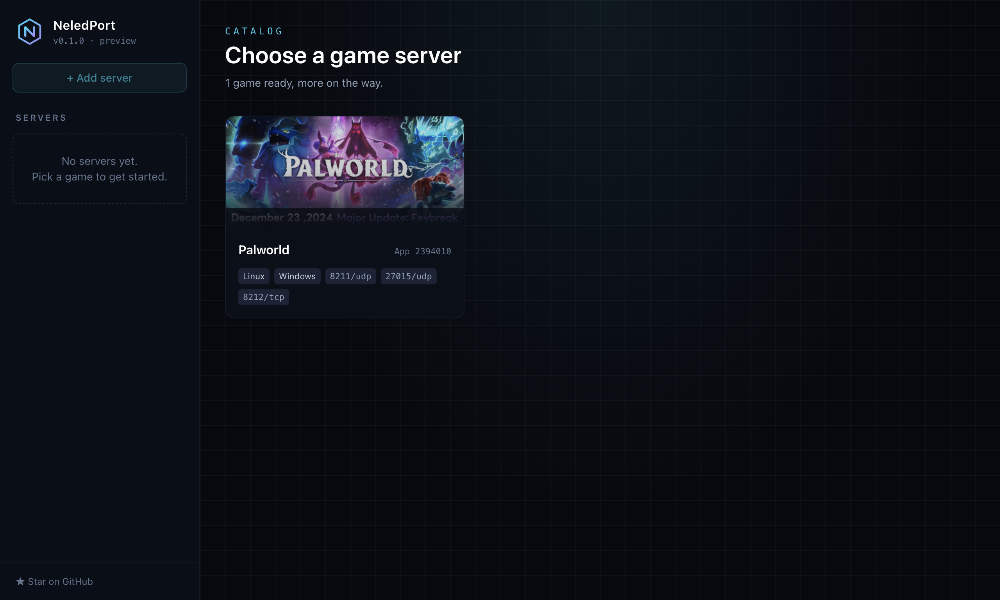

<div align="center">


# NeledPort

**เปิดเซิร์ฟเวอร์เกม Steam ได้ในโปรแกรมเดียว ดีไซน์ทันสมัย**
ติดตั้ง รัน ดูสถานะ จัดการผู้เล่น และใส่ม็อด โดยไม่ต้องพิมพ์คำสั่งใน terminal

[English](README.md) · ภาษาไทย



</div>

> NeledPort อยู่ระหว่างพัฒนาช่วงแรก กด ⭐ เพื่อติดตามความคืบหน้า หรือ[เพิ่มเกมที่คุณชอบ](CONTRIBUTING.md#add-a-game) เข้ามาในรายการได้เลย

## ฟีเจอร์ (เป้าหมายของ v1.0)

- **ติดตั้งในคลิกเดียว:** โปรแกรมโหลด SteamCMD ให้เอง แล้วใช้ติดตั้ง อัปเดต และตรวจไฟล์เซิร์ฟเวอร์
- **Start / Stop / Restart:** สั่งเซฟโลกก่อนปิดเซิร์ฟเวอร์ทุกครั้ง
- **คอนโซลสด:** ค้นหาข้อความ log ได้ และมีช่องส่งคำสั่ง (RCON / stdin)
- **สถานะ:** uptime, CPU, RAM และจำนวนผู้เล่นออนไลน์
- **ผู้เล่นและการแบน:** เตะ แบน และปลดแบนผ่านระบบของเกมนั้นโดยตรง
- **ม็อด:** ติดตั้ง mod loader ฝั่งเซิร์ฟเวอร์ (BepInEx, Oxide/Carbon, Metamod + CounterStrikeSharp) และโหลดม็อดจาก Steam Workshop
- **สำรองข้อมูลอัตโนมัติ** ก่อนอัปเดตทุกครั้ง
- **หลายภาษา:** ตอนนี้มีอังกฤษ (ภาษาหลัก) และไทย เพิ่มภาษาใหม่ได้ด้วยไฟล์เดียว ([วิธีแปล](CONTRIBUTING.md#translate-neledport))

## เกมที่รองรับ

ตอนนี้กำลังทำ Palworld ต่อไปคือ Rust, Valheim และ Counter-Strike 2 จากนั้นจะเพิ่มเซิร์ฟเวอร์ Steam อีกกว่า 100 เกม และรองรับการใส่ App ID เองได้ทุกตัว
แต่ละเกมคือไฟล์ JSON 1 ไฟล์ในโฟลเดอร์ [`games/`](games) ส่วนวิธีเพิ่มเกมอยู่ใน [CONTRIBUTING.md](CONTRIBUTING.md#add-a-game)

## สำหรับนักพัฒนา

```bash
npm install
npm run dev
npm test
```

## ข้อกฎหมาย

NeledPort ไม่ได้เกี่ยวข้องกับ Valve หรือผู้จัดจำหน่ายเกมรายใด โปรแกรมโหลด SteamCMD และไฟล์เซิร์ฟเวอร์จาก Valve ตอนใช้งานจริง และไม่แจกจ่ายไฟล์เหล่านั้นเอง
เผยแพร่ภายใต้ [MIT License](LICENSE)
