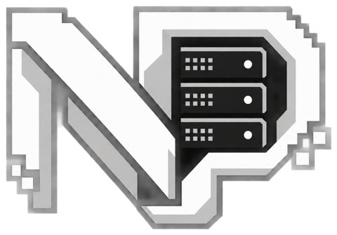
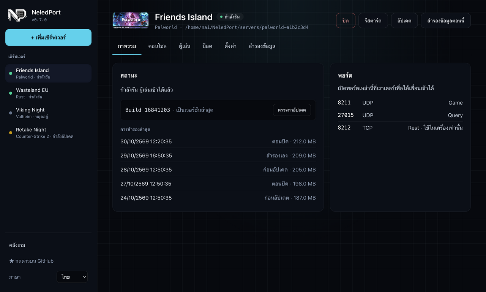

<div align="center">



# NeledPort

**เปิดเซิร์ฟเวอร์เกม Steam ได้ในโปรแกรมเดียว ดีไซน์ทันสมัย**
ติดตั้ง รัน ดูสถานะ จัดการผู้เล่น และใส่ม็อด โดยไม่ต้องพิมพ์คำสั่งใน terminal

[English](README.md) · ภาษาไทย



</div>

> NeledPort อยู่ระหว่างพัฒนาช่วงแรก กด ⭐ เพื่อติดตามความคืบหน้า หรือ[เพิ่มเกมที่คุณชอบ](CONTRIBUTING.md#add-a-game) เข้ามาในรายการได้เลย

## ฟีเจอร์

- **ติดตั้งในคลิกเดียว:** โปรแกรมโหลด SteamCMD ให้เอง แล้วใช้ติดตั้ง อัปเดต และตรวจไฟล์เซิร์ฟเวอร์
- **Start / Stop / Restart:** สั่งเซฟโลกก่อนปิดเซิร์ฟเวอร์ทุกครั้ง
- **คอนโซลสด:** ค้นหาข้อความ log ได้ และมีช่องส่งคำสั่ง (RCON / stdin)
- **ผู้เล่นและการแบน:** เตะ แบน และปลดแบนผ่านระบบของเกมนั้นโดยตรง
- **ม็อด:** ติดตั้ง mod loader ฝั่งเซิร์ฟเวอร์ (BepInEx สำหรับ Valheim, Oxide สำหรับ Rust) จัดการปลั๊กอิน และโหลดแมพจาก Steam Workshop ให้ CS2
- **ตั้งค่า:** แก้ค่าเซิร์ฟเวอร์ได้หลังสร้างแล้ว และแก้ไฟล์ตั้งค่าของเกมเองได้ในโปรแกรม (Palworld, Rust, CS2) โดยเก็บไฟล์เดิมไว้ให้
- **สำรองข้อมูล:** สำรองให้อัตโนมัติก่อนอัปเดตทุกครั้ง หรือกด **สำรองข้อมูลตอนนี้** และกู้คืนได้ในคลิกเดียว โลกปัจจุบันจะถูกย้ายไปเก็บไว้ ไม่ถูกลบ
- **อัปเดตตัวเอง:** บน Windows และ AppImage โปรแกรมโหลดเวอร์ชันใหม่ให้ แล้วกด **รีสตาร์ตเพื่ออัปเดต**
- **หลายภาษา:** ตอนนี้มีอังกฤษ (ภาษาหลัก) และไทย เพิ่มภาษาใหม่ได้ด้วยไฟล์เดียว ([วิธีแปล](CONTRIBUTING.md#translate-neledport))

แผนต่อไป: กราฟ uptime และ CPU/RAM, command palette, ธีมสว่าง

## ดาวน์โหลด

ดาวน์โหลดตัวติดตั้งสำหรับ Windows (`.exe`) หรือ Linux (`.AppImage`, `.deb`) ได้ที่
[Releases](https://github.com/NexwestLedgerCoreCompanyLimited/NeledPort/releases)

> ตัวติดตั้งยังไม่ได้ลงลายเซ็นดิจิทัล Windows SmartScreen อาจเตือนตอนเปิดครั้งแรก ให้กด **More info → Run anyway**

## เกมที่รองรับ

- **รองรับเต็มรูปแบบ:** Palworld, Valheim, Rust (ทดสอบกับเซิร์ฟเวอร์จริงทุกสัปดาห์: Valheim บน Linux และ Windows, Palworld บน Linux)
- **พื้นฐาน (ติดตั้ง รัน คอนโซล):** Counter-Strike 2, SCUM, ARK, Team Fortress 2, Satisfactory และอีก 70+ เกม ([รายชื่อทั้งหมด](docs/GAMES.md))
- **เกมที่ต้องใช้บัญชี Steam** เช่น ARMA 3 และ DayZ: ล็อกอินครั้งเดียวในหน้าต่าง SteamCMD ของ Valve เอง NeledPort ไม่เห็นรหัสผ่าน
- **App ID อะไรก็ได้:** ค้นหาเซิร์ฟเวอร์อีก 380+ ตัวจากชื่อ ติดตั้ง แล้วเลือกโปรแกรมที่ใช้เปิดครั้งเดียว

แต่ละเกมคือไฟล์ JSON 1 ไฟล์ในโฟลเดอร์ [`games/`](games) ส่วนวิธีเพิ่มเกมอยู่ใน [CONTRIBUTING.md](CONTRIBUTING.md#add-a-game)

## สำหรับนักพัฒนา

```bash
npm install
npm run dev
npm test
```

## ข้อกฎหมาย

NeledPort ไม่ได้เกี่ยวข้องกับ Valve หรือผู้จัดจำหน่ายเกมรายใด โปรแกรมโหลด SteamCMD และไฟล์เซิร์ฟเวอร์จาก Valve ตอนใช้งานจริง และไม่แจกจ่ายไฟล์เหล่านั้นเอง
เผยแพร่ภายใต้ [MIT License](LICENSE)
